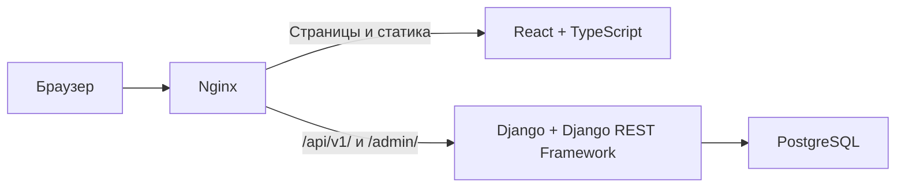

# Отчётность родительских комитетов

Веб-приложение для учёта сборов, взносов и расходов класса. Казначей ведёт учёт и прикладывает чеки к расходам. Родитель видит свои начисления и взносы, а также общую сводку по расходам класса.

## Архитектура проекта



React отвечает за экраны, навигацию и состояние интерфейса. Vite используется для разработки и сборки фронтенда. Браузер обращается к API по относительному пути `/api/v1/`. Django валидирует данные, проверяет права доступа и выполняет операции учёта. Для входа через браузер используются сессии Django. Nginx обслуживает фронтенд и направляет запросы к API и панели администратора в Django. Сервисы объединены через Docker Compose.

## Структура репозитория

```text
frontend/
  src/
    main.tsx   # Точка входа React
    app/       # Корневой компонент, маршрутизация и общие макеты страниц
    pages/     # Компоненты экранов и их стили
    assets/    # Изображения и другие ресурсы, импортируемые в компонентах
    features/  # Модули сборов, расходов и отчётов
    shared/    # Общие компоненты и HTTP-клиент
    css/       # Глобальные стили, шрифты и CSS-переменные
    mocks/     # Демонстрационные данные
  package.json        # Зависимости и команды разработки, сборки и линтинга
  package-lock.json   # Точные версии зависимостей для npm ci
  vite.config.ts      # Настройки Vite и плагина React
  Dockerfile          # Образ фронтенда для запуска Vite
backend/
  ...
  Dockerfile
docker-compose.yaml   # Сервисы для разработки
compose.prod.yaml     # Сервисы для рабочего окружения
```

Страницы получают данные через функции своих модулей, например `listCollections(classId)` и `getCollection(collectionId)`. Один и тот же интерфейс функций позволяет использовать демонстрационные данные при вёрстке и HTTP-запросы при работе с API.

## Локальный запуск через Docker Compose

Конфигурация `docker-compose.yaml` запускает фронтенд на Vite. Выполняйте команды из корня репозитория.

### Windows

Установите и запустите Docker Desktop, затем откройте PowerShell в корне репозитория. [Установка Docker Desktop на Windows](https://docs.docker.com/desktop/setup/install/windows-install/)

```powershell
docker compose version
docker compose up --build
```

### Linux

Установите Docker Engine и плагин Docker Compose для своего дистрибутива. Убедитесь, что Docker запущен, и откройте терминал в корне репозитория. [Установка Docker Engine](https://docs.docker.com/engine/install/) · [Установка плагина Compose](https://docs.docker.com/compose/install/linux/)

```bash
docker compose version
docker compose up --build
```

### Открытие сайта

После запуска Docker Compose перейдите в браузере по адресу [localhost:80](http://localhost:80).

### Остановка

Чтобы остановить запуск в активном терминале, нажмите `Ctrl+C`. Чтобы остановить и удалить контейнеры и сеть проекта, выполните из корня репозитория команду, одинаковую для Windows и Linux.

```bash
docker compose down
```

## Роли и модель учёта

- **Казначей** создаёт сборы, задаёт начисления, отмечает взносы и добавляет расходы с чеками.
- **Родитель** видит начисления и взносы своей семьи и общую сводку расходов. Сведения о задолженностях других семей доступны казначею.

Для каждого участника сбора создаётся отдельное начисление. Это позволяет включить в сбор только часть класса и назначить разные суммы. Взносы учитываются отдельно от начислений, поэтому по одному начислению можно отразить несколько частичных оплат. Моки должны включать общий сбор с одинаковой суммой, выборочный сбор с разными суммами и закрытый сбор с расходами и чеками.

Запуск проекта в первый раз в терминале:

# Создать виртуальное окружение:

py -3.14 -m venv backend/.venv

# Активировать:

.\backend\.venv\Scripts\Activate.ps1

# Установить зависимости

pip install -r backend/requirements.txt

# Подготовка Frontend

cd frontend
npm install

# Вернуться в корень:

cd ..

# Из корня репозитория:

docker compose up -d db

# Подготовка базы данных

cd backend
python manage.py migrate

# Создать собственного администратора:

python manage.py createsuperuser

# Запуск бэкенда:

python manage.py runserver

# Запуск фронта

cd frontend
npm run dev
