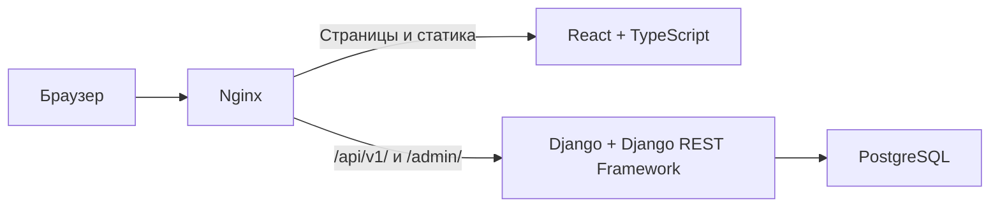

# Отчётность родительских комитетов

Веб-приложение для учёта сборов, взносов и расходов класса. Казначей ведёт учёт и прикладывает чеки к расходам. Родитель видит свои начисления и взносы, а также общую сводку по расходам класса.

## Архитектура проекта



React отвечает за экраны, навигацию и состояние интерфейса. Vite используется для разработки и сборки фронтенда. Браузер обращается к API по относительному пути `/api/v1/`. Django валидирует данные, проверяет права доступа и выполняет операции учёта. Для входа через браузер используются сессии Django. Nginx обслуживает фронтенд и направляет запросы к API и панели администратора в Django. Сервисы объединены через Docker Compose.

## Структура репозитория

```text
frontend/
  src/
    main.tsx   # Точка входа React
    app/       # Корневой компонент, маршрутизация и общие макеты страниц
    pages/     # Компоненты экранов и их стили
    assets/    # Изображения и другие ресурсы, импортируемые в компонентах
    features/  # Модули сборов, расходов и отчётов
    shared/    # Общие компоненты и HTTP-клиент
    css/       # Глобальные стили, шрифты и CSS-переменные
    mocks/     # Демонстрационные данные
  Dockerfile          # Сборка фронтенда и образ Nginx
backend/
  config/             # Настройки Django, корневые маршруты и WSGI
  apps/               # Django-приложения по предметным областям
  manage.py
  Dockerfile
compose.yaml          # Сервисы для разработки
compose.prod.yaml     # Сервисы для рабочего окружения
```

Страницы получают данные через функции своих модулей, например `listCollections(classId)` и `getCollection(collectionId)`. Один и тот же интерфейс функций позволяет использовать демонстрационные данные при вёрстке и HTTP-запросы при работе с API.

## Роли и модель учёта

- **Казначей** создаёт сборы, задаёт начисления, отмечает взносы и добавляет расходы с чеками.
- **Родитель** видит начисления и взносы своей семьи и общую сводку расходов. Сведения о задолженностях других семей доступны казначею.

Для каждого участника сбора создаётся отдельное начисление. Это позволяет включить в сбор только часть класса и назначить разные суммы. Взносы учитываются отдельно от начислений, поэтому по одному начислению можно отразить несколько частичных оплат. Моки должны включать общий сбор с одинаковой суммой, выборочный сбор с разными суммами и закрытый сбор с расходами и чеками.

